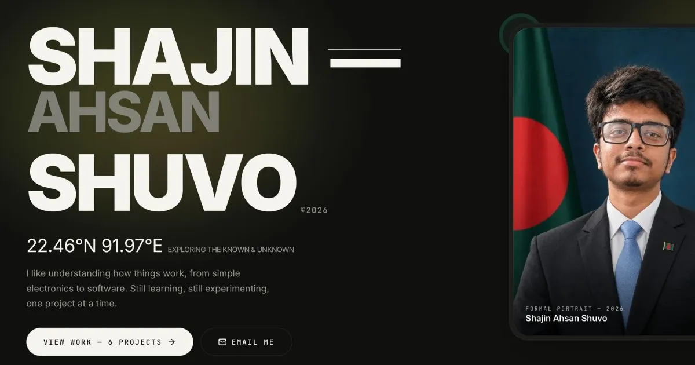

<div align="center">



<br />
<br />

# shajin.me

**Curious about everything. Certain about nothing.**

My portfolio, built like I build everything else: take it apart, understand it, put it back better.

<br />


**[Live site →](https://shajin.me)**

</div>

<br />

```text
shajin@me ~ % whoami
shajinahsan

shajin@me ~ % cat about.txt
CSE student at CUET, Chittagong.
Hardware x software. Arduino and ESP32 on the bench, Next.js on the screen.
Currently teaching a drone to stand still.

shajin@me ~ % ls ~/projects
web/  systems/  embedded/  experiments/
```

---

## The tour

| Section       | What's there                               | The interesting part                                                                                             |
| ------------- | ------------------------------------------ | ---------------------------------------------------------------------------------------------------------------- |
| **Hero**      | Name, portrait, a glow behind the headline | The glows are radial gradients with a flat core, not CSS `blur()`. Safari butchers big blurs.                    |
| **About**     | Bio, skills, hobbies, and a terminal       | The terminal is real. Type into it.                                                                              |
| **Education** | Academic timeline and a skill tree         | The tree shows what each thing I learned _unlocked_. Older nodes fold away so it never grows taller.             |
| **Work**      | Six project cards                          | Five of them are hand-built simulations of the actual hardware or software.                                      |
| **Now**       | What I'm doing this month                  | A full-width drone simulation: a gust shoves it off its hover point, it overshoots, corrects, and locks back on. |
| **Contact**   | A form that sends real email               | Server Action, validation, honeypot. No form service in the middle.                                              |

The weather card in the Work section shows live Dhaka weather, cached for 10 minutes.

---

## Six animations, zero animation libraries

Every moving thing on this site is CSS keyframes or SVG's built-in timing (SMIL). No GSAP, no Framer Motion, no canvas, no JavaScript animation loop.

| Where                      | What you're watching                                                                      | How                                                                              |
| -------------------------- | ----------------------------------------------------------------------------------------- | -------------------------------------------------------------------------------- |
| **Drone card**             | A drone tilts in a gust and levels itself while a gyro trace draws and motor bars shift   | One shared 6s CSS loop, so every part stays in sync                              |
| **Remote Wall Socket**     | ESP32 raises a pin, the relay snaps shut, a bulb lights up                                | CSS keyframes: wires that draw themselves, opacity swaps, a flickering filament  |
| **Line Following Car**     | A car drives a track while a sensor dot and motor bars track the curves                   | SVG `animateMotion`, with the readouts generated from the track's real curvature |
| **Tesla Dashcam**          | A viewfinder with a pulsing detection box and an event timeline                           | Tailwind and SVG                                                                 |
| **Face Attendance Logger** | Faces get scanned, matched against a database, and logged. One person is never recognised | A 14s CSS loop, one keyframe per face                                            |
| **Now**                    | The gust-and-recover simulation, in 3/4 view over a moving perspective grid               | SVG SMIL on a single timeline                                                    |

All of them respect `prefers-reduced-motion`: visitors who ask for less motion get a still frame that still tells the story.

---

## Try the terminal

Scroll to **About** and let it type itself out. Then it's yours.

```text
help          list commands
about         who I am
skills        what I work with
projects      things I've built
contact       say hi
open <x>      jump to a section (work, about, skills, education, now, contact)
theme         switch light / dark, from inside the terminal
neofetch      system info
clear         clear the screen
```

`↑` / `↓` for history, `Tab` to complete, `Ctrl+L` to clear. On a phone, tap the shortcut buttons under it.

There are a few commands `help` won't tell you about. Think like a recruiter. Or like someone who just got `permission denied`.

---

## Under the hood

- **Server components by default.** Most of the page renders on the server. Interactive client components handle the theme toggle, mobile navigation, terminal, contact form, section interactions and games.
- **Static, with fresh data.** The page is prerendered, and the weather is fetched inside a `"use cache"` function that revalidates every 10 minutes. If the API fails, the card says so instead of breaking the page.
- **Content lives in `data/`.** Projects, skills, the skill tree and the "Now" section are plain TypeScript objects. Changing what the site says doesn't mean touching a component.
- **Dark mode without the flash.** `next-themes` sets a class before first paint, and Tailwind's `dark:` variant is wired to it.
- **Contact form.** A Server Action validates input, rejects bots with a hidden honeypot field, and sends mail through [Resend](https://resend.com). Your message is kept in the form if sending fails.
- **Social previews.** The Open Graph image is 1200x630, with everything important inside the middle 630x630 square. Facebook crops link previews to 1:1 in some places, and this survives it.
- **Fonts** through `next/font`: Inter, Instrument Serif and JetBrains Mono.

---

## Run it locally

You'll need Node 20.9 or newer (Vercel builds it on 24.x).

```bash
git clone https://github.com/ShajinAhsan/personal-portfolio.git
cd personal-portfolio
npm install
cp .env.example .env.local
npm run dev
```

Open [http://localhost:3000](http://localhost:3000).

### Environment variables

| Variable               | Needed for                   | If it's missing                                    |
| ---------------------- | ---------------------------- | -------------------------------------------------- |
| `NEXT_PUBLIC_SITE_URL` | Metadata, sitemap, robots    | Falls back to `http://localhost:3000`              |
| `RESEND_API_KEY`       | The contact form             | The form shows a friendly "not set up yet" message |
| `CONTACT_TO_EMAIL`     | Where messages are delivered | Defaults to my inbox                               |
| `CONTACT_FROM_EMAIL`   | The sender address           | Defaults to Resend's test sender                   |
| `OPENWEATHER_API_KEY`  | The live weather card        | The card shows "Live data unavailable right now"   |
| `UPSTASH_REDIS_REST_URL` | Contact-form rate limiting | Rate limiting is unavailable until both Upstash values are set |
| `UPSTASH_REDIS_REST_TOKEN` | Contact-form rate limiting | Rate limiting is unavailable until both Upstash values are set |

The site runs fine with none of these set. It just can't send email or show live weather. Keep keys in `.env.local` and never commit them. They're only ever read on the server.

### Scripts

```bash
npm run dev     # local dev server
npm run build   # production build
npm run start   # serve the production build
npm run lint    # eslint
```

---

## Map of the repo

```text
app/
  layout.tsx            fonts, metadata, theme provider
  page.tsx              the page, section by section
  actions.ts            contact form Server Action (Resend)
  icon.svg              site icon
  globals.css           design tokens + every keyframe
components/
  Hero, About, Education, Work, Now, Contact, Footer, Header
  *Card.tsx             the animated project cards
  TerminalCard.tsx      the interactive terminal
  Learning.tsx           the learning timeline
  Skills.tsx             the skills section
  ThemeToggle, MobileMenu, ContactForm
data/                   profile, projects, skills, learning, now
lib/weather.ts          cached OpenWeather fetch
```

---

## Make it yours

If you're forking this, change the words first:

1. **`data/profile.ts`** has your name, links, emails and nav.
2. **`data/skills.ts`** has the skill groups.
3. **`data/learning.ts`** has the skill tree. Add a node when you learn something new, and set `status` to `"done"`, `"now"` or `"locked"`.
4. **`data/now.ts`** has the "Now" section text.
5. **`data/projects.ts`** has the project cards' text.
6. **`public/portrait.jpg`** is the photo. Swap it for yours.

The project cards are hand-built, one component each, so a new project means a new card. Copy the closest existing one and change the scene.

---

## Deploy

Built for [Vercel](https://vercel.com). Import the repo, add the environment variables above, and set `NEXT_PUBLIC_SITE_URL` to your real domain. Until you verify a domain in Resend, keep the default test sender.

After changing the social preview image, paste the URL into Facebook's Sharing Debugger and scrape again, because it caches aggressively.

---

## Design notes

- **Palette:** a warm off-white (`#FCFCF9`) and a near-black (`#10100F`) with three accents. Lime (`#E6FF55`) is the signature. The two Bangladesh flag colors, green (`#006A4E`) and red (`#F42A41`), show up in small, intentional places.
- **Type:** Inter for UI and headlines, Instrument Serif for the voice, JetBrains Mono for everything that feels like a label or a readout.
- **Tone:** mono labels like `(04) — Work`, terminal windows, and "simulated, not live data" printed on every simulation.

---

## The bug museum

Things that broke while building this, kept here because they were worth learning:

- **Big `blur()` glows look wrong in Safari.** They get clipped to a hard edge. Replaced with radial gradients that have a flat core.
- **A 12-column grid with `gap-8` overflows at 320px.** Eleven gaps of 32px don't fit. Column gaps now only apply where the columns actually exist.
- **The mobile menu needs a bounded panel.** It now has its own viewport-aware height and native scrolling for short or landscape screens.
- **Throwing inside a `"use cache"` function fails the build.** The weather fetch catches its own errors and returns `null`.
- **Pasting `module.exports = {...}` into `next.config.ts` deleted the Tailwind loader.** Hello, `Unknown at rule: @custom-variant`.

---

## Credits

The first draft of the design was a single-file prototype generated with Meta AI. I rebuilt it as a Next.js app, pair-programming with AI along the way, and designed and wrote everything that makes it mine: the simulations, the terminal, the content.

Icons by [Lucide](https://lucide.dev). Fonts from Google Fonts.

## License

Feel free to read the code and learn from it. The name, photo, copy and project write-ups are mine. Please don't ship them as yours.
